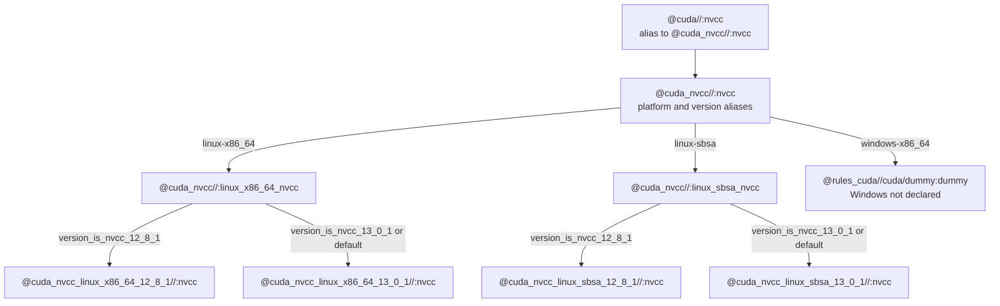

# CUDA repository hierarchy

| Configuration                   | `@cuda//toolchain`                                  | Implementations                      |
| ------------------------------- | --------------------------------------------------- | ------------------------------------ |
| Local CTK                       | Implementations and registrations                   | Inside `@cuda`                       |
| One `redist_json` release       | Versioned and default registrations                 | One `@cuda_toolchain_<version>` repo |
| Multiple `redist_json` releases | Registrations for every release; highest is default | One repo per release                 |

The [template README](https://github.com/bazel-contrib/rules_cuda/blob/main/cuda/private/templates/README.md)
shows the complete generated layouts. Redistribution facades have no `defs.bzl`;
version helpers belong to the component and implementation repositories.

## Component selection

For releases 12.8.1 and 13.0.1 declared on Linux x86_64 and SBSA, the component
aliases resolve as follows. Intermediate execution-platform and ARM aliases are
omitted.



`nvcc` and `nvvm` follow the execution platform; libraries follow the target
platform. A release-specific alias such as `@cuda_nvcc_toolchain_12_8_1` uses the
same platform selection but points only to 12.8.1 component repositories.

## Toolchain selection

Generated BUILD excerpts (unrelated attributes omitted):

```starlark
# @cuda//toolchain/BUILD
config_setting(
    name = "toolkit_version_is_12_8_1",
    flag_values = {"@rules_cuda//cuda:version": "12.8.1"},
)
toolchain(
    name = "nvcc-linux-12_8_1-toolchain",
    target_settings = [
        "@rules_cuda//cuda:is_enabled",
        "@rules_cuda//cuda:compiler_is_nvcc",
        ":toolkit_version_is_12_8_1",
    ],
    toolchain = "@cuda_toolchain_12_8_1//toolchain:nvcc-linux",
    toolchain_type = "@rules_cuda//cuda:toolchain_type",
    # platform constraints and visibility omitted
)

# @cuda_toolchain_12_8_1//toolchain/BUILD
alias(name = "nvcc-linux", actual = "//toolchain/nvcc:nvcc-local", visibility = ["//visibility:private"])

# @cuda_toolchain_12_8_1//toolchain/nvcc/BUILD
cuda_toolchain(
    name = "nvcc-local",
    compiler_label = "@cuda_nvcc_toolchain_12_8_1//:nvcc",
    toolchain_config = ":nvcc-local-config",
    # compiler_files omitted
)
```

With `--@rules_cuda//cuda:version=12.8.1 --@rules_cuda//cuda:compiler=nvcc`,
**analysis** selects this toolchain and resolves its compiler label through the
platform aliases. **Execution** runs that compiler; selection does not happen at
runtime. An unset version selects the highest declared release; an undeclared
version fails toolchain resolution when CUDA is enabled.
